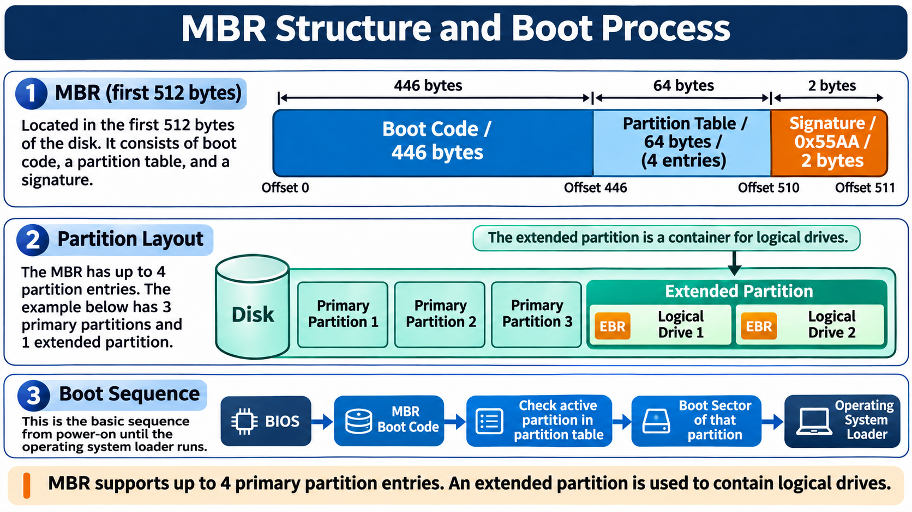

파일 시스템 구조

생성된 파일을 관리하기 위한 정보들이 메타 영역에 기록됨
- 이름 위치 크기 시간 데이터영역 주소 등

LBA logical block addressing 방식 사용
섹터와 클러스터 단위로 데이터를 기록
- 섹터 512 byte 할당
- Cluster 크기는 512 * 8 = 4kbyte

Data Area에서 우리가 파일을 삭제하고 수정하고 기타 등등 작업을 수행하더라도 결국에는 원본 데이터가 Meta Area에 잔존하여 남는 것을 알 수 있다.

파일 시스템 구조를 조금 더 디테일하게 살펴본다면,,,

MBR은 저장 매체의 첫 번째 섹터에 위치하는 512 바이트 크기의 영역이다.
부트 코드 호출을 담당.

- Boot code ( 446 Byte)
- Partion 1
	- 파티션 각 영역은 할당이 될 수도 있고 할당 되지 않을 경우도 존재
- Partion 2
- Partion 3
- Partion 4
- Partion 5
- Signature
	- 마지막 Signature가 깨져 있으면 파일 시스템이 깨져있다고 생각할 수 있음

### FAT 32
- FAT(File allocation Table)는 파일의 할당 정보르 표현한 테이블을 지정
- 간단한 구조로 메모리 카드, 디지털 카메라, 플래시 메몸리에 등에 널리 사용
- FAT 뒤의 숫자는 비트 수로 표현 가능한 클러스터의 수를 의미

