---

## 1. 전체 구성

| 역할 | VM | OS | 망 | IP | VMnet |
|---|---|---|---|---|---|
| 방화벽 / IDS | Firewall | pfSense 2.7.2 | 전 구간 | WAN 192.168.0.200 / LAN 10.10.10.1 / OPT1 10.10.20.1 / OPT2 10.10.30.1 | NAT / VMnet1 / VMnet2 / VMnet3 |
| 관제 PC | Clone of soc | Ubuntu | LAN (내부망) | 10.10.10.100 | VMnet1 |
| 개발 PC (DMZ 접근용) | DevPC | Ubuntu | LAN (내부망) | 10.10.10.150 | VMnet1 |
| SIEM (ELK + Wazuh) | Elastick_Stack | Ubuntu 20.04 Server | OPT1 (관제망) | 10.10.20.120 | VMnet2 |
| 관제 대상 웹서버 | Webserver | Ubuntu | OPT2 (DMZ) | 10.10.30.100 | VMnet3 |

pfSense 인터페이스 매핑은 `le0=WAN`, `le1=LAN`, `le2=OPT1`, `le3=OPT2`

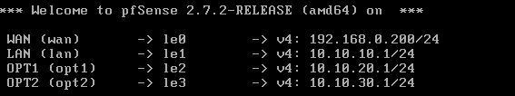
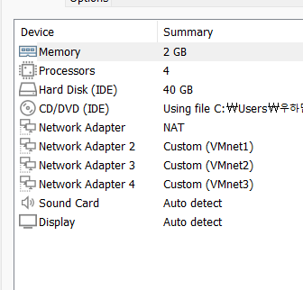


### 로그 수집 흐름

| 로그 | 경로 | Elasticsearch 인덱스 |
|---|---|---|
| Wazuh 알람 | Webserver Wazuh Agent → Wazuh Manager → Filebeat → Logstash `5044/TCP` | `wazuh-alerts-*` |
| 웹 접근 로그 | Webserver Filebeat(apache 모듈) → Logstash `5046/TCP` | `web-access-log-*` |
| 방화벽 로그 | pfSense syslog → Logstash `5045/UDP` | `pfsense-firewall-*` |
| Snort 탐지 | pfSense syslog → Logstash `5045/UDP` | `pfsense-snort-*` |

### 가이드와 다르게 적용한 부분

| 항목                  | 가이드                        | 실제 적용                                       |
| ------------------- | -------------------------- | ------------------------------------------- |
| ELK 버전              | 7.5.1 (직접 설치)              | 기존 서버의 **7.16.2** 재사용 (JDK 내장이라 Java 설치 생략) |
| Logstash Java 경로 설정 | `/etc/default/logstash` 수정 | 하지 않음 (7.16.2 내장 JDK 사용)                    |
| 메모리                 | SIEM 4GB                   | ES 힙 1GB, Logstash 힙 512MB로 제한              |
| Wazuh용 filebeat.yml | 다운로드 후 vi로 수정              | 필요한 내용만 새로 작성                               |
| auditd 규칙 적용        | `systemctl restart auditd` | `augenrules --load`                         |
| Kibana 차트           | 7.5 UI 기준                  | 7.16 UI 기준 (User_Agent는 Lens Donut)         |
| 웹서버 Filebeat        | 7.5.1                      | 7.5.1 + `seccomp.enabled: false`            |
|                     |                            |                                             |

---

## 2. 방화벽 (pfSense)

### 2.1 설치 및 인터페이스 설정

콘솔 메뉴 `1) Assign Interfaces`, `2) Set interface(s) IP address`로 WAN·LAN·OPT1·OPT2를 할당

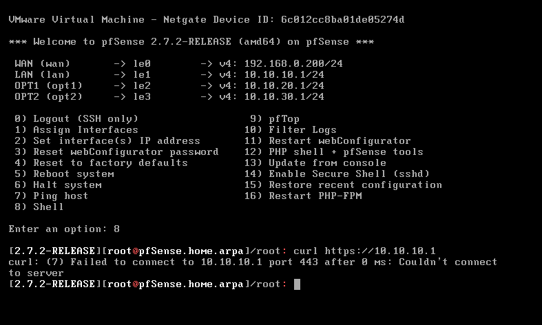

LAN 쪽 Ubuntu는 고정 IP로 설정(게이트웨이 `10.10.10.1`, DNS `8.8.8.8`)

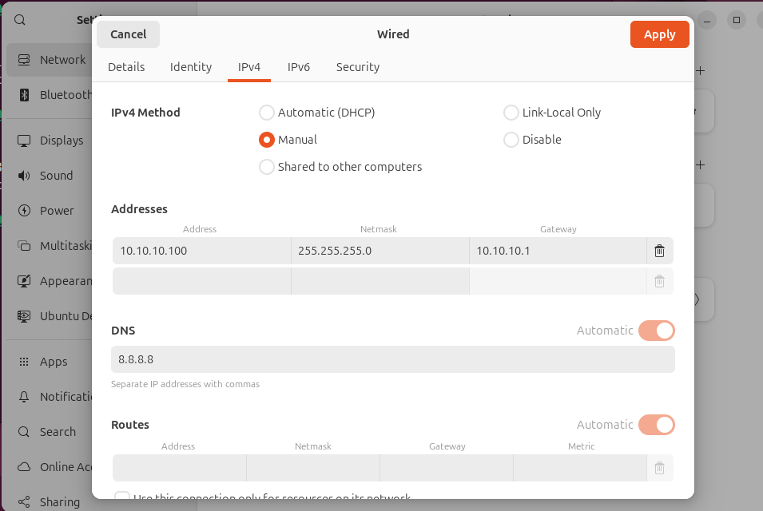


### 2.2 초기 설정 위저드

LAN(`https://10.10.10.1`)으로 웹GUI에 접속해 위저드로 진행


**System → General Setup**

- Hostname: `pfSense` / Domain: `pfmanage.com`
- DNS: `168.126.63.1`, `8.8.8.8`
- Timezone: `Asia/Seoul`


**Interfaces → WAN**: 외부(192.168.0.x)에서 포트포워딩으로 들어올 수 있도록 `Block private networks`는 해제, `Block bogon networks`는 체크

### 2.3 방화벽 규칙

LAN, OPT1, OPT2 각각에 아래 허용 규칙을 추가했습니다. (pfSense는 규칙이 없는 인터페이스의 트래픽을 전부 차단합니다.)

| Interface | Action | Protocol | Source | Destination |
|---|---|---|---|---|
| LAN | Pass | Any | LAN subnets | Any |
| OPT1 | Pass | Any | OPT1 subnets | Any |
| OPT2 | Pass | Any | OPT2 subnets | Any |

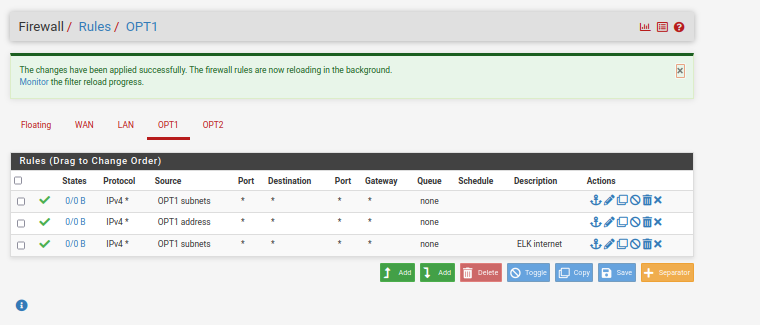


### 2.4 Snort (IDS)

**System → Package Manager**에서 `snort`를 설치

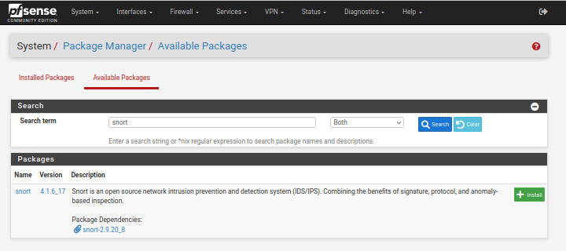

**Services → Snort → WAN 인터페이스 설정**

- Interface: `WAN (le0)`
- Send Alerts to System Log: 체크
- **Block Offenders: 해제** (실습 목적상 차단하지 않고 탐지·알림만 하는 IDS 모드)


**WAN Preprocs → HTTP Inspect → Server Configurations**: `Post Depth`를 `0`으로 변경 (POST 본문 전체 검사)

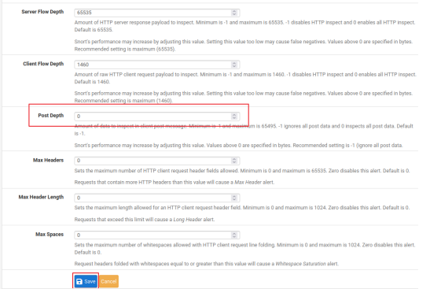

> 탐지를 하려면 Global Settings에서 룰셋(ET Open, Snort GPLv2 Community)을 켜고 Updates → WAN Categories까지 설정

### 2.5 원격 로그 전송

**Status → System Logs → Settings → Remote Logging Options**

- Source Address: `Default (any)`
- Remote log server: `10.10.20.120:5045`
- Contents: System Events, Firewall Events

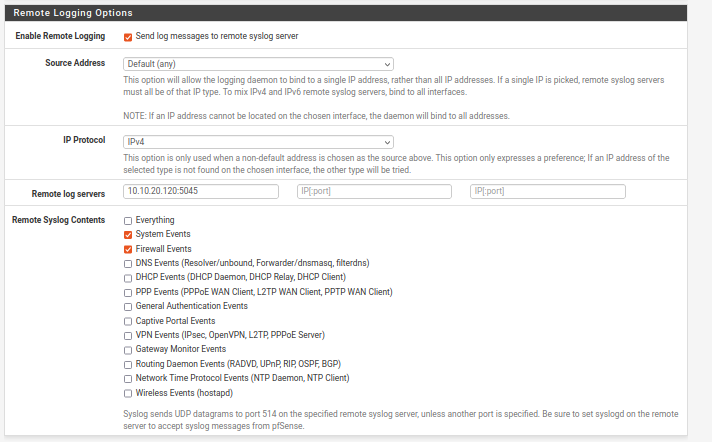

### 2.6 포트포워딩 (외부 → DMZ 웹서버)

**Firewall → NAT → Port Forward**

- Interface: WAN / TCP / Destination: WAN address : HTTP
- Redirect target: `10.10.30.100` : HTTP
- Filter rule association: Add associated filter rule (WAN 규칙 자동 생성)
- 생성된 WAN 규칙에 **Log** 옵션을 켜서 외부 접근이 방화벽 로그로 남도록 함


### 2.7 패킷 캡처

**Diagnostics → Packet Capture**에서 WAN(le0) 캡처 후 `.pcap`으로 다운로드드

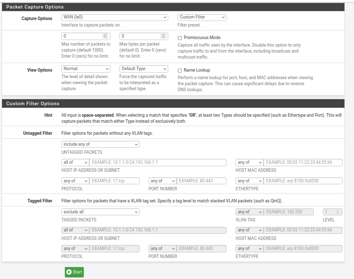
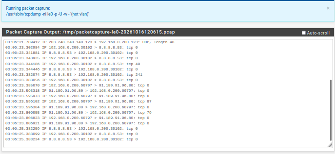

---

## 3. 관제 대상 웹서버 (DMZ)

- IP `10.10.30.100/24`, GW `10.10.30.1`, VMnet3, RAM 2GB
- Apache2 설치·실행


### 3.1 Filebeat (웹 로그 → Logstash 5046)

```bash
sudo dpkg -i filebeat-7.5.1-amd64.deb
sudo filebeat modules enable apache
# /etc/filebeat/filebeat.yml 수정 → configs/webserver/filebeat-output.yml 참고
sudo filebeat test config
sudo systemctl enable --now filebeat
```

### 3.2 Wazuh Agent + auditd

```bash
curl -fSLo wazuh-agent-3.10.2.deb https://packages.wazuh.com/3.x/apt/pool/main/w/wazuh-agent/wazuh-agent_3.10.2-1_amd64.deb
sudo WAZUH_MANAGER="10.10.20.120" dpkg -i wazuh-agent-3.10.2.deb
sudo /var/ossec/bin/agent-auth -m 10.10.20.120
# ossec.conf에 수집 로그 추가 → configs/webserver/ossec-agent-localfile.xml

sudo apt-get install -y auditd audispd-plugins
# 감시 규칙 → configs/webserver/custom.rules 를 /etc/audit/rules.d/ 에 저장
sudo augenrules --load
sudo auditctl -l

sudo systemctl enable wazuh-agent
sudo systemctl restart wazuh-agent
```

SIEM에서 `agent_control -l`로 에이전트가 **Active**인지 확인

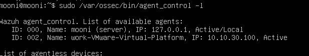

---

## 4. SIEM (ELK 7.16.2 + Wazuh 3.10.2)

기존에 ELK 7.16.2가 설치된 서버(192.168.10.10)를 SIEM으로 전환

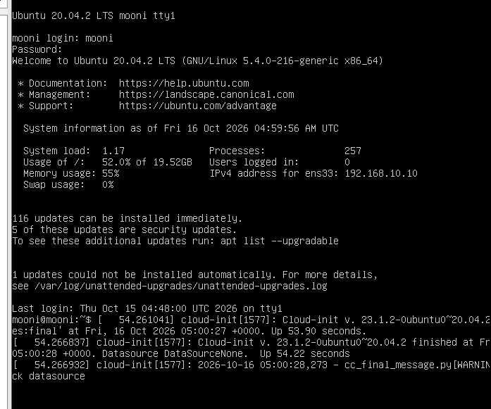


### 4.1 네트워크 변경 (192.168.10.10 → 10.10.20.120)

```bash
# cloud-init이 네트워크 설정을 덮어쓰지 않도록
echo "network: {config: disabled}" | sudo tee /etc/cloud/cloud.cfg.d/99-disable-network-config.cfg
# /etc/netplan/00-installer-config.yaml → configs/siem/netplan/ 참고
sudo netplan try
sudo netplan apply
```

VMware에서 NIC를 VMnet2(OPT1)로 변경


### 4.2 Elasticsearch / Kibana 설정

`/etc/elasticsearch/elasticsearch.yml`

```yaml
node.name: node-1
network.host: 10.10.20.120
cluster.initial_master_nodes: ["node-1"]
```

`/etc/kibana/kibana.yml`

```yaml
server.host: "0.0.0.0"
elasticsearch.hosts: ["http://10.10.20.120:9200"]
```

메모리 정리 (RAM 3.8GB 환경)

```bash
printf -- "-Xms1g\n-Xmx1g\n" | sudo tee /etc/elasticsearch/jvm.options.d/heap.options
sudo sed -i 's/^-Xms1g/-Xms512m/; s/^-Xmx1g/-Xmx512m/' /etc/logstash/jvm.options
sudo systemctl disable --now grafana-server   # 이번 실습에서 사용하지 않음
```

기존 Logstash 설정(`beats.conf`, `pfsense.conf`)은 포트 충돌을 막기 위해 `/etc/logstash/conf.d.bak/`로 옮겼습니다.

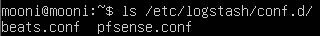

Kibana 접속 확인 (`http://10.10.20.120:5601`). 보안 기능(Enable security)은 켜지 않았습니다. 켜면 Logstash가 인증 없이 Elasticsearch에 쓰지 못함함


### 4.3 Wazuh Manager

```bash
curl -s https://packages.wazuh.com/key/GPG-KEY-WAZUH | sudo apt-key add -
echo "deb https://packages.wazuh.com/3.x/apt/ stable main" | sudo tee -a /etc/apt/sources.list.d/wazuh.list
sudo apt-get update
sudo apt install wazuh-manager=3.10.2-1
sudo curl -s https://packages.wazuh.com/3.x/filebeat/wazuh-filebeat-0.1.tar.gz | sudo tar -xvz -C /usr/share/filebeat/module
```

- `ossec.conf`의 `jsonout_output yes`, `email_notification no` 등은 3.10.2 기본값 그대로 사용
- 커스텀 규칙: `configs/siem/wazuh/local_rules.xml` (www-data 명령 실행, root 명령, nc/wget/curl, cron 변경 탐지)
- Filebeat(Wazuh 알람 → Logstash 5044): `configs/siem/filebeat.yml`

```bash
sudo /var/ossec/bin/ossec-analysisd -t && sudo systemctl restart wazuh-manager
```

### 4.4 Logstash 파이프라인

`/etc/logstash/conf.d/`에 4개 파일을 배치했습니다. → `configs/siem/logstash/`

| 파일 | 입력 | 출력 인덱스 |
|---|---|---|
| `01-wazuh.conf` | beats 5044 | `wazuh-alerts-*` |
| `02-web-access.conf` | beats 5046 | `web-access-log-*` |
| `03-pfsense.conf` | udp 5045 | `pfsense-firewall-*` |
| `04-snort.conf` | (03과 같은 입력) | `pfsense-snort-*` |

```bash
sudo /usr/share/logstash/bin/logstash --path.settings /etc/logstash -t
sudo systemctl restart logstash filebeat
sudo ss -lntup | grep -E '5044|5045|5046'
curl -s "http://10.10.20.120:9200/_cat/indices?v" | grep -E 'wazuh|web-access|pfsense'
```

---

## 5. Kibana 대시보드 (7.16)

### 5.1 인덱스 패턴

**☰ → Stack Management → Index Patterns**에서 생성 (Timestamp field: `@timestamp`)

- `web-access-log*` (Default)
- `pfsense-firewall-*`
- `wazuh-alerts-*`

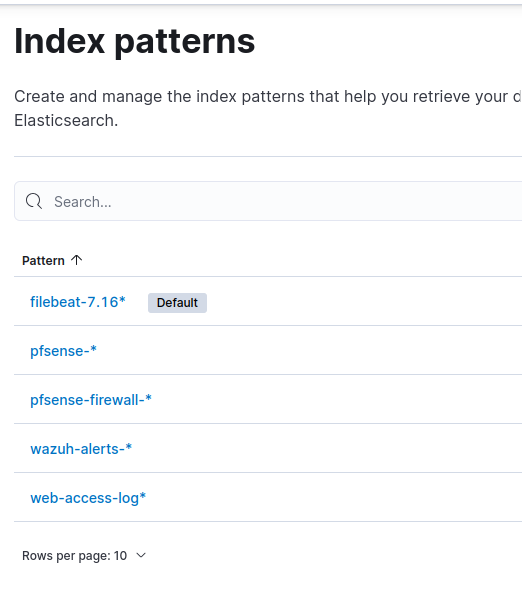

### 5.2 시각화 (Visualize Library → Lens)

| 이름 | 필드 | 형태 |
|---|---|---|
| Top Source IP | `clientip.keyword` | Bar |
| HTTP Method | `verb.keyword` | Table |
| HTTP Response | `response.keyword` | Table |
| User_Agent | `original_user_agent.keyword` | Donut |

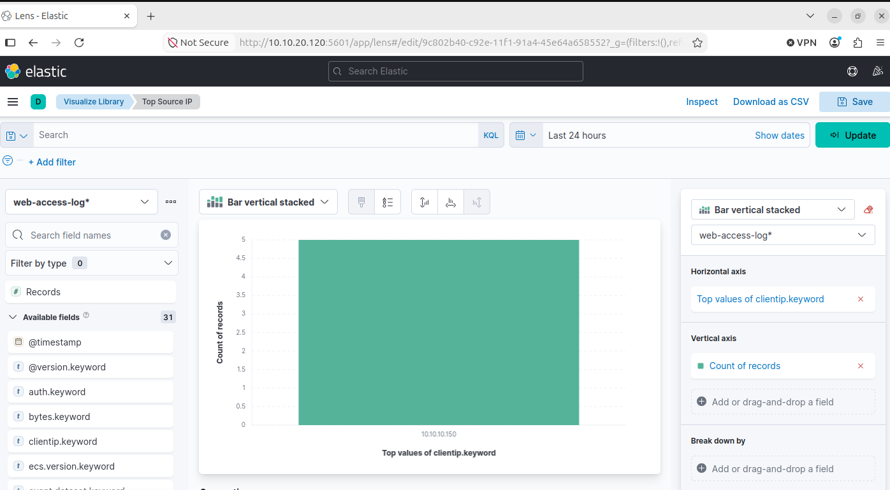

### 5.3 대시보드

**☰ → Dashboard → Create dashboard → Add from library**로 4개 패널을 추가하고 `Web Monitoring Dashboard`로 저장했습니다.

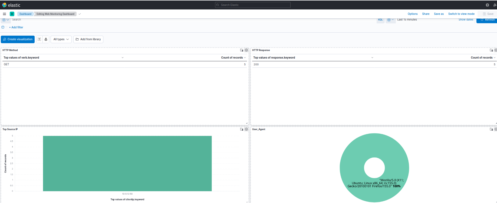

---

## 6. 트러블슈팅

| # | 증상 | 원인 | 해결 |
|---|---|---|---|
| 1 | LAN에서 `ping 10.10.10.1` 실패 (ARP·MAC은 정상) | LAN 허용 규칙 없음 → pf가 차단 | `pfctl -d`로 원인 확인 후 LAN Pass 규칙 추가 |
| 2 | 위저드 Reload 중 웹GUI 연결 끊김 | WAN 주소로 접속 중이었고, reload 시 pf가 다시 켜짐 | 웹GUI는 LAN(`10.10.10.1`)으로 접속 |
| 3 | SIEM `netplan try`에서 default route 충돌 | 설정 파일에 기본 게이트웨이 중복 선언 | 파일 정리 후 재적용 |
| 4 | SIEM 메모리 부족 (3.3GB/3.8GB 사용) | 기존 ELK, Grafana가 모두 기본 힙으로 실행 중 | ES 힙 1GB, Logstash 512MB, Grafana 비활성화 |
| 5 | 호스트 메모리 부족으로 VM 부팅 불가 | 웹서버 VM에 RAM 6GB가 할당돼 있었음 | 2GB로 축소 |
| 6 | Kibana 503 `License is not available` | `kibana.yml`의 `elasticsearch.hosts`가 주석 → localhost로 접속 시도 | `http://10.10.20.120:9200`으로 수정 |
| 7 | 웹서버에서 게이트웨이(10.10.30.1) 통신 불가 | VMware 가상 NIC 연결 꼬임 (설정은 정상) | VM 재시작 |
| 8 | Wazuh Agent `Never connected` | 에이전트가 Manager에 접속하지 못한 상태 | 웹서버에서 `wazuh-agent` 재시작 |
| 9 | pfSense 로그가 SIEM에 안 옴 | Remote Logging 설정이 적용되지 않음 | 설정 재저장 (syslog 재시작) |
| 10 | 방화벽 로그가 어제 날짜 인덱스에 저장됨 | pfSense 시간대 변경이 재부팅 전까지 미적용 → UTC로 전송 | pfSense 재부팅 |
| 11 | 웹서버 Filebeat 7.5.1이 시작 직후 crash | 구버전 Filebeat의 seccomp가 최신 Ubuntu 시스템 호출 차단 | `seccomp.enabled: false` 추가 |

### 주요 화면

**#1 LAN ping 실패 — ARP는 응답(REACHABLE)하지만 ping은 실패**

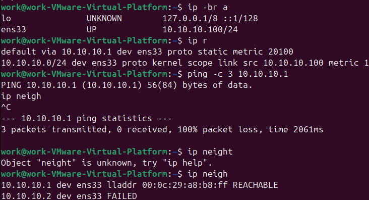

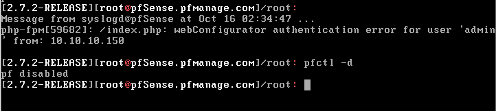

**#2 위저드 Reload 중 연결 끊김**


**#3 netplan default route 충돌**


**#4, #5 메모리 부족**


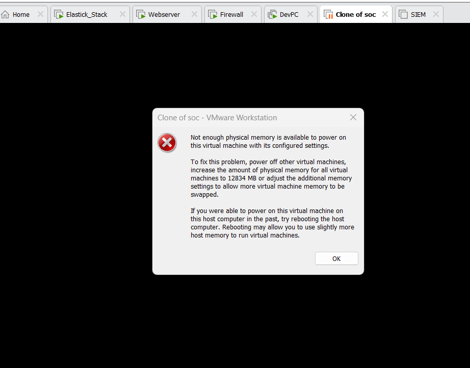

**#6 Kibana 503**


**#7 pfSense에서도 웹서버로 ping 불가**

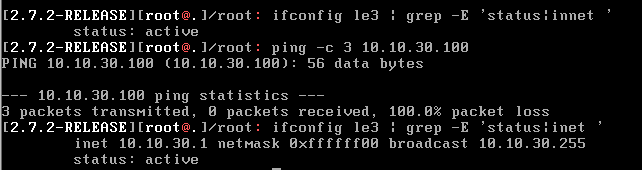

**#8 Wazuh Agent Never connected → Manager는 UDP 1514 정상 대기**


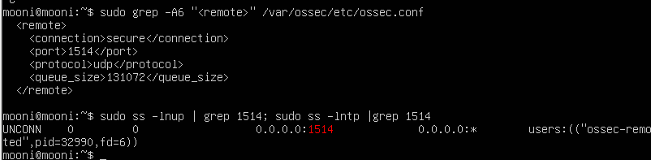

---

## 7. 최종 확인

### 7.1 내부망 → DMZ 웹서버

DevPC(10.10.10.150, LAN)에서 `http://10.10.30.100`으로 접속해 Apache 페이지 확인.
LAN Pass 규칙에 따라 pfSense가 LAN → DMZ로 라우팅합니다.


### 7.2 외부망 → DMZ 웹서버 (포트포워딩)

외부(Windows 호스트, VMnet8)에서 WAN 주소 `http://192.168.0.200`으로 접속하면 포트포워딩을 거쳐 DMZ 웹서버(10.10.30.100:80)의 페이지가 열립니다.

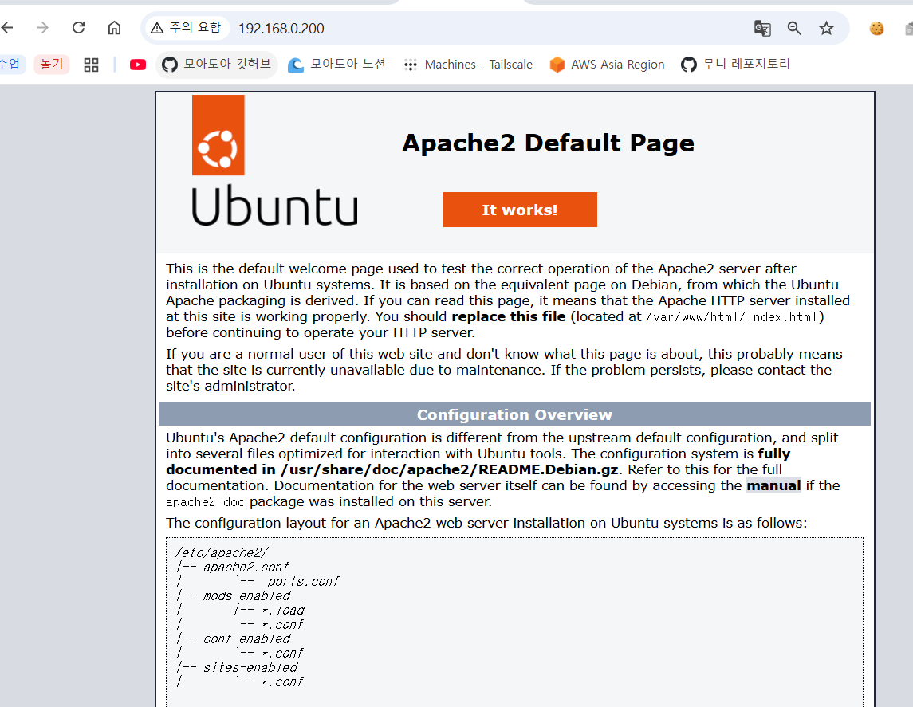

## 8. 남은 작업

- [ ] Snort 룰셋(ET Open, GPLv2 Community) 다운로드 및 WAN Categories 선택 → `pfsense-snort-*` 인덱스 생성 확인
- [ ] WAN(공격자) 쪽에서 웹 공격 트래픽 발생시켜 대시보드·탐지 확인
- [ ] (선택) DMZ → LAN 차단 규칙 추가

## 디렉터리 구조

```
.
├── README.md
├── images/          # 구축·트러블슈팅 스크린샷
└── configs/
    ├── siem/
    │   ├── netplan/00-installer-config.yaml
    │   ├── filebeat.yml
    │   ├── logstash/01-wazuh.conf … 04-snort.conf
    │   └── wazuh/local_rules.xml
    └── webserver/
        ├── filebeat-output.yml
        ├── ossec-agent-localfile.xml
        └── custom.rules
```
